<div align="center">


# Nexference

**Local-first AI provider and client management workspace**

Discover providers, manage models, configure supported AI clients, run a local Anthropic-compatible proxy for Claude Code, and keep configuration changes safe — all from one local dashboard.

[](package.json)
[](https://nodejs.org)
[](https://expressjs.com)
[](https://developer.mozilla.org/en-US/docs/Web/JavaScript)
[](LICENSE)

</div>

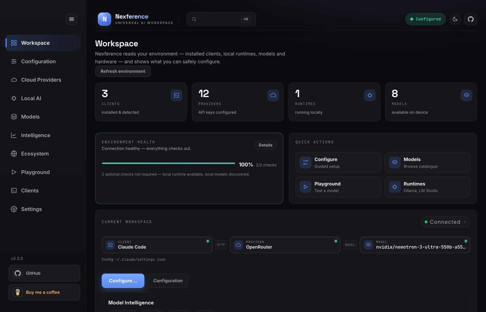

## Overview

Nexference v2.4.0 is a local-first AI provider and client management workspace built with Node.js, Express, and vanilla JavaScript ES modules. It runs as a local web app and brings together provider discovery, curated/adopted/custom provider management, model exploration, execution, local runtime awareness, supported client configuration, a local Anthropic-compatible proxy, fallback workflows, and environment visibility.

The project is intentionally scoped around two principles:

- **Honesty over marketing claims:** provider status, integration behavior, and compatibility are distinguished from metadata-only records.
- **Local-first control:** provider and workspace state stays on the local machine, while the proxy session is kept in server memory and supported configuration writes use backup and verification safeguards.

> This README reflects the current repository state. Nexference is an evolving portfolio project; implemented, partial, and planned behavior are called out separately.

## Project Overview

At a high level, the browser UI talks to a local Express API. That API coordinates provider registries, discovery services, model/intelligence endpoints, execution routes, local runtime checks, client configuration stores, and the local proxy. Upstream AI providers are contacted by the server, while Claude Code or other supported clients interact with local endpoints and generated configuration.

## Project Status

| Area | Status in v2.4.0 |
|---|---|
| Provider discovery and provenance | Implemented |
| Curated/adopted/custom provider management | Implemented |
| Model catalogue and provider intelligence | Implemented, dependent on upstream endpoints and parsers |
| Unified execution gateway | Implemented for supported routes/capabilities |
| Local Anthropic-compatible proxy | Implemented for supported OpenAI-compatible/Gemini-provider paths |
| Fallback and recovery | Implemented in the dashboard workflow; active monitoring depends on an open tab |
| Local runtime management | Detection and configuration assistance where supported |
| Claude Code configuration | Managed flow implemented for `~/.claude/settings.json` |
| Other client configuration | Mixed assisted/manual/detection-only support |
| Automated test suite / CI | Not present in this repository |
## Key Features

| Area | What it does | User benefit |
|---|---|---|
| **Ecosystem discovery** | Discovers provider records from configured/implemented sources and normalizes them into inspectable records. | See where provider information came from before adopting it. |
| **Provider registries** | Works with curated providers, adopted/discovered dynamic providers, and user-created custom providers. | Manage different provider origins in one workspace. |
| **Model catalogue & intelligence** | Fetches/caches model data, classifies model availability/pricing signals where available, and exposes provider/model intelligence. | Compare models with more context and fewer guesswork labels. |
| **Unified execution** | Routes execution through the server-side execution gateway/adapters where supported. | Use one execution path instead of provider-specific UI logic. |
| **Local proxy for Claude Code** | Exposes a loopback Anthropic-compatible endpoint and translates requests to supported upstream provider dialects. | Use supported OpenAI-compatible/Gemini-provider paths from Claude Code without writing provider keys to Claude settings. |
| **Fallback & recovery** | Client-side fallback monitoring with per-client plans, tiered fallback, cooldown/fail thresholds, and auto-revert behavior (while dashboard is open). | Reduce manual recovery during provider/model failures. |
| **Local runtime management** | Detects local runtimes/models and exposes runtime-aware configuration paths. | Use local AI tools alongside cloud providers. |
| **Client registry & configuration** | Detects registered clients and provides capability-aware configuration flows. | Understand what Nexference can configure automatically vs. manually. |
| **Configuration safety** | Preview/diff, backup, atomic write, and verification/re-read for supported config writes, with proxy-disconnect restore and manually initiated backup restore. | Reduce risk when changing client config files. |
| **Workspace observability** | Environment health, activity, intelligence, topology, playground, and backup views. | Inspect what the system knows and what it changed. |

## Screenshots

All screenshots below are from `docs/screenshots/` and reflect captured workspace states.

### Workspace & discovery

| Dashboard | Ecosystem discovery |
|---|---|
|  | 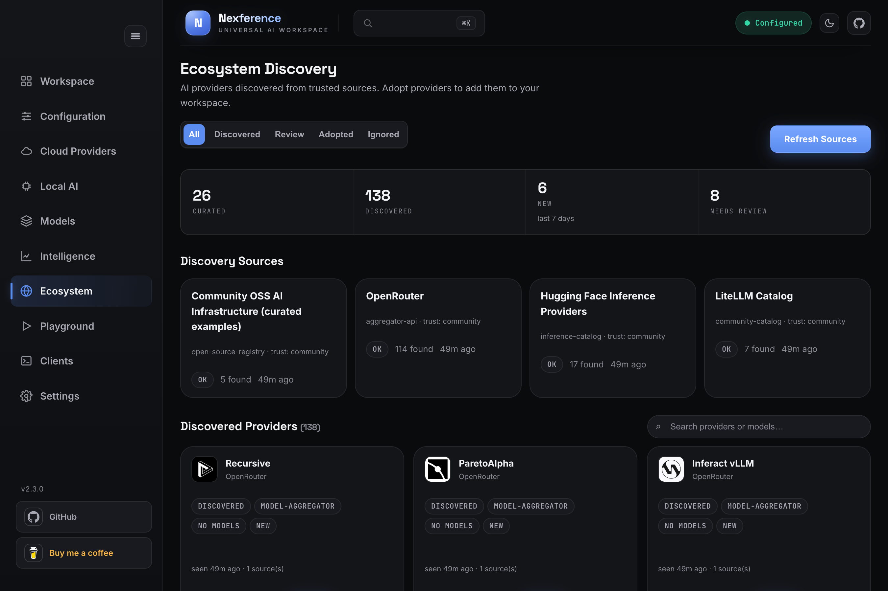 |
| *Main workspace with environment/provider visibility and quick navigation.* | *Discovery-oriented view for inspecting provider sources and ecosystem records.* |

### Providers & models

| Provider details | Cloud providers |
|---|---|
| 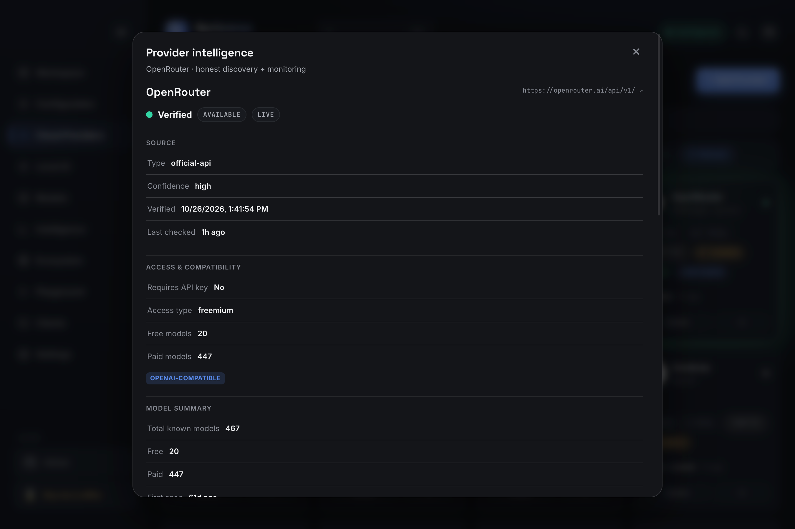 | 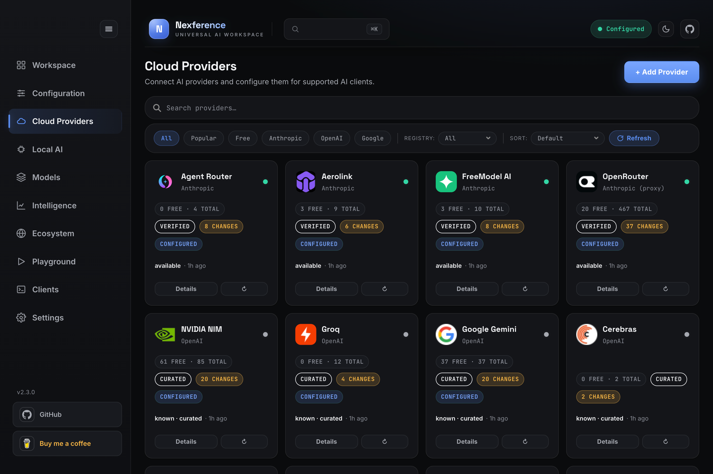 |
| *Provider-level details, status, and available actions.* | *Cloud provider catalogue with registry/filter-oriented management.* |

| Custom providers | Playground |
|---|---|
| 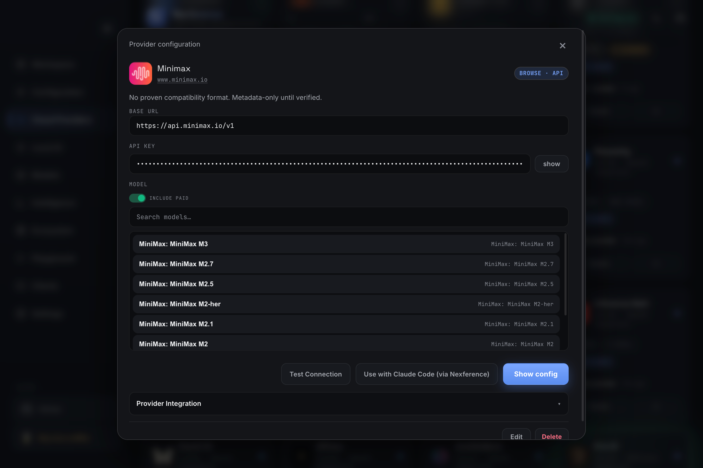 | 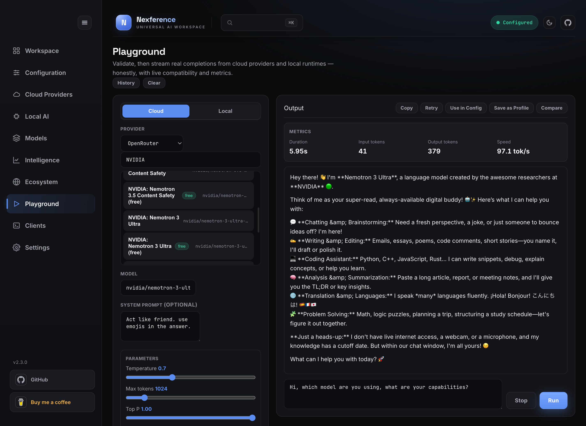 |
| *User-created/custom provider management.* | *Execution/playground surface for model testing and comparison workflows.* |

### Configuration & safety

| Configuration workspace | Configuration diff |
|---|---|
| 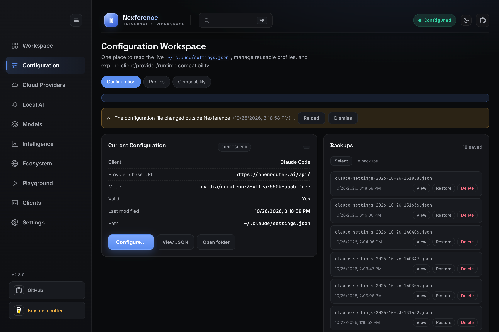 | 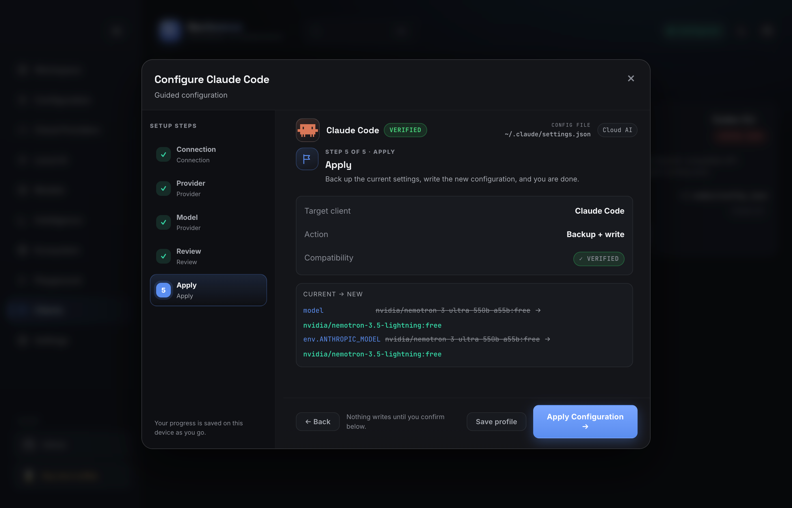 |
| *Guided configuration workspace for supported client setup.* | *Review changes before applying them to a supported config target.* |

| Fallback system | Intelligence center |
|---|---|
| 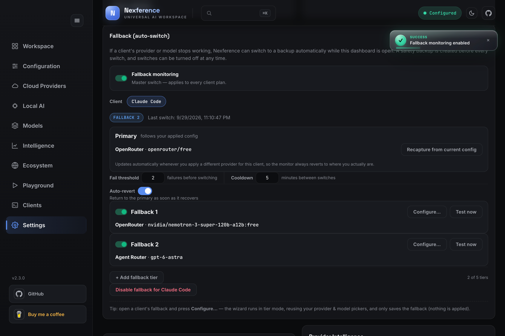 | 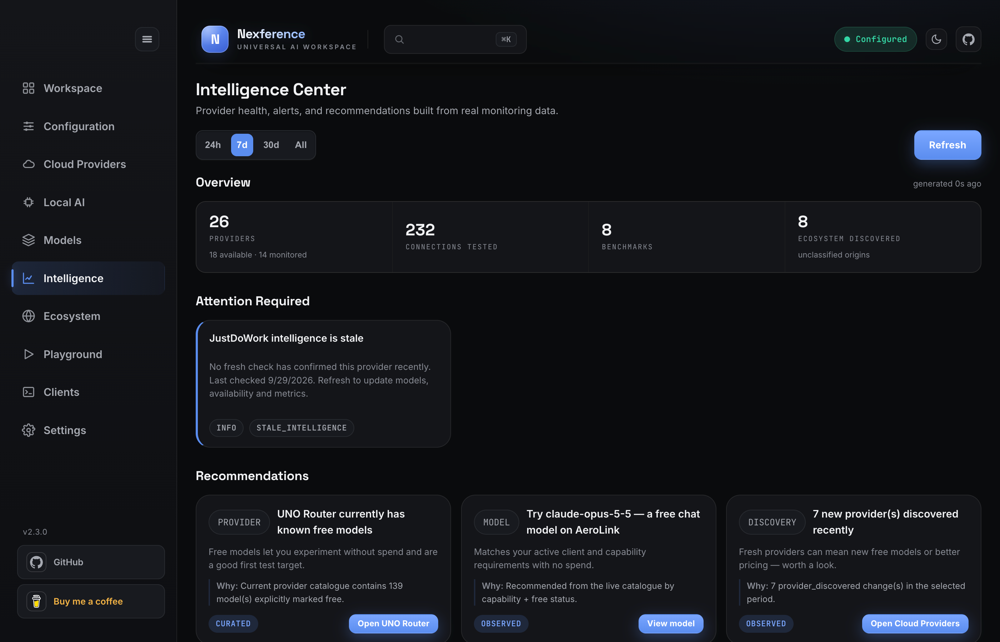 |
| *Fallback plan/tier management and recovery controls.* | *Provider/model intelligence and monitoring-oriented insights.* |

### Clients

| Client registry |
|---|
| 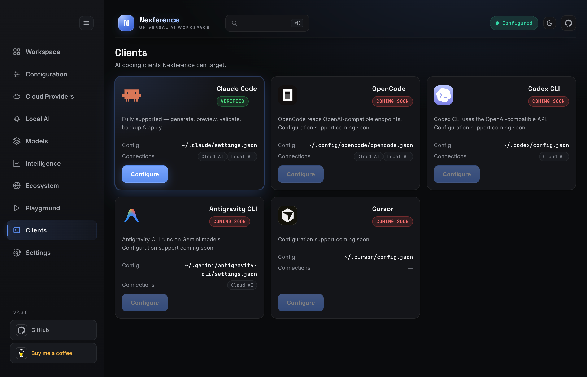 |
| *Registered clients with capability-aware support/detection status.* |

## Architecture Overview

Nexference is a local web app served by an Express server. The frontend is static ES-module JavaScript under `public/`; backend services and routes live under `src/server/`.

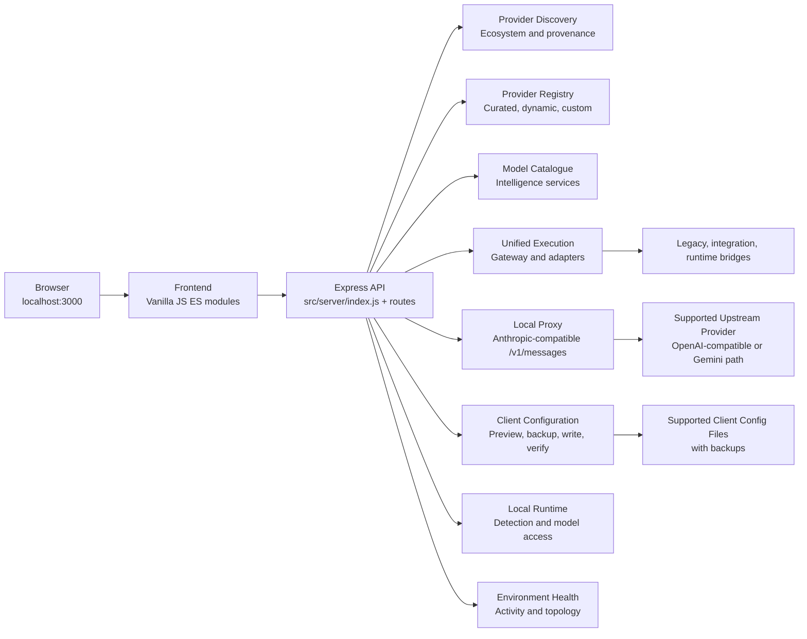

### Key implementation areas

- **Server entry**: `server.js` starts `src/server/index.js`.
- **API/routes**: `src/server/routes/*` (config, providers, custom providers, ecosystem, execution, local proxy, health, etc.).
- **Provider/model services**: `src/server/providers/*`, `src/server/models/*`, `src/server/execution/*`.
- **Local proxy**: `src/server/proxy/proxyRouter.js`, `proxyStore.js`, `anthropicCodec.js`.
- **Config safety**: `src/server/config/*` (settings/backup/config services and client-specific stores).
- **Frontend UI**: `public/index.html`, `public/src/ui/*`, `public/src/components/*`.

## Technology Stack

| Layer | Technology | Notes |
|---|---|---|
| Runtime | Node.js | README badge targets Node 20+; verify your local Node version before running. |
| Server | Express 5 (`express@^5.1.0`) | Local HTTP server and API routes. |
| Frontend | Vanilla JavaScript (ES Modules), HTML, CSS | No React/Vue/TypeScript build pipeline in the repository. |
| Module system | ESM (`"type": "module"`) | Server and frontend modules use ES module syntax. |
| Storage | Local filesystem + browser localStorage | Config backups/files on disk; browser stores some workspace/provider UI state (never treat browser storage as a secret vault). |
| License | MIT | See [`LICENSE`](LICENSE). |

**Not claimed:** Docker setup, CI/CD pipelines, cloud deployment config, database server, TypeScript migration, or frontend framework build — unless added in the repository.

## Provider Integrations

Nexference separates **discovery**, **configuration/integration metadata**, and **execution**. A provider being discoverable does not mean it is fully configurable or executable in every client.

### Provider origins

- **Curated providers** — built-in provider records in the server/client registries.
- **Adopted/dynamic providers** — ecosystem/discovered providers that can be adopted into the managed workflow.
- **Custom providers** — user-created provider records stored locally by Nexference.

### Curated provider registry (server-side, verified in `src/server/providers/registry.js`)

| Provider | Format | Public model listing | Notes (from code) |
|---|---|---:|---|
| Agent Router | `anthropic` | Yes | Pricing endpoint configured. |
| AeroLink | `anthropic` | Yes | Public model endpoint behavior configured. |
| FreeModel | `anthropic` | Yes | Public model endpoint behavior configured. |
| OpenRouter | `openai` | Yes | OpenAI-compatible API format. |
| NVIDIA NIM | `openai` | No | Configured for keyed provider behavior. |
| Groq | `openai` | No | Excludes non-chat model classes from catalogue paths. |
| Gemini | `gemini` | No | Also declares an OpenAI-compatible surface for proxy/compat paths. |
| Cerebras | `openai` | No | Public model list API configured. |
| Orca Router | `openai` | Yes | Pricing endpoint configured. |
| Mistral | `openai` | No | Scrape/default-paid handling configured. |
| Hugging Face | `openai` | No | Router endpoint configured. |
| Chutes | `openai` | No | Public model list API configured. |
| TokenRouter | `openai` | No | Bearer-auth, pricing, and scrape behavior configured; OpenAI-compatible path is relevant to proxy compatibility. |

### Integration capabilities (verified direction)

- **Provider records** can include format, base URL, auth expectations, model listing strategy, and compatibility metadata.
- **Custom providers** support CRUD, validation, test-connection flows, duplicate checks, and lifecycle operations through server routes/services.
- **Execution support** is resolved by the execution gateway/capabilities layer; metadata-only or unsupported routes should be treated as non-executable until verified.

## Local Proxy and Claude Code Integration

The local proxy exists because Claude Code speaks the **Anthropic Messages API** shape, while many useful providers expose **OpenAI-compatible** (or Gemini-compatible) APIs. Nexference can act as a local translation hop.

### Actual flow

```text
Claude Code
  -> http://127.0.0.1:3000/v1/messages (Anthropic-compatible local endpoint)
  -> Nexference proxy/router + codec
  -> Supported upstream provider (OpenAI-compatible or configured Gemini-compatible path)
  -> Translated response/stream back to Anthropic-compatible shape
```

### Verified/implemented behavior (inspect `src/server/proxy/*`)

- **Loopback-only access**: proxy endpoints reject non-loopback requests (`127.0.0.1`, `::1`, localhost forms handled).
- **Proxy auth token required**: requests to `/v1/*` proxy endpoints require the generated proxy token (`x-api-key` or `Authorization: Bearer ...`), checked with constant-time comparison.
- **In-memory session state**: proxy store keeps token/upstream key/session details in memory only; it is not written to disk by the proxy store.
- **Upstream keys are not written to Claude settings by proxy design**: proxy flow is intended to avoid placing upstream provider API keys into `~/.claude/settings.json`.
- **Provider resolution**: supports dynamic/custom/curated provider IDs, including curated provider OpenAI-compatible surface where declared (e.g., Gemini `openaiCompat`).
- **Streaming/translation**: `anthropicCodec.js` handles request/response/stream translation and error mapping for supported paths.
- **Claude Code compatibility decision**: compatibility logic uses project compatibility helpers (including proxy-eligible OpenAI-compatible paths), not a naive “Anthropic format only” check.

### Important limitations

- **Not full Anthropic API compatibility**. The proxy implements the translation paths needed by the supported Claude Code workflow; do not assume every Anthropic API feature/edge case is supported.
- **Not every provider is proxy-compatible**. Compatibility depends on provider format, declared compatibility surface, credentials, and upstream behavior.
- **Session is ephemeral**. When Nexference stops/restarts, the armed in-memory proxy session/token is lost.
- **Do not expose the local service publicly**. It is designed for loopback/local use; exposing it to untrusted networks is unsafe.
- **Credentials still matter**. Upstream provider keys are supplied to Nexference for proxying; treat them as sensitive and avoid sharing logs/screenshots containing secrets.

## Fallback and Recovery System

Nexference includes a fallback model/plan concept in the UI/config workflow and client-side monitoring behavior. The README documents the behavior as implemented/represented in the current project state; validate in your environment before relying on it for critical workflows.

### Intended/implemented behavior

- **Per-client fallback plans**: primary + fallback tiers (UI/store supports multiple tiers; recent work targets up to 5 tiers).
- **Failure detection**: monitor/probe logic checks active provider/model health while the dashboard is open.
- **Cooldown/fail threshold**: configurable controls to avoid rapid flapping.
- **Auto-switch**: can move to next enabled tier after repeated real failures.
- **Primary-first recovery / auto-revert**: can probe primary and revert when healthy (when enabled).
- **Exhausted behavior**: if tiers fail, system can mark degraded/revert to primary according to plan logic.

### Honest limitations

- **No zero-downtime guarantee**. Fallback reduces disruption; it cannot guarantee uninterrupted model responses.
- **Dashboard-open monitoring**: client-side monitoring depends on an open Nexference tab/session; closing the dashboard stops active monitoring.
- **External config changes**: safety logic should avoid fighting manual/external changes; review pending changes before applying.
- **Provider/model-specific failures**: auth, rate limits, model removal, upstream outages, and unsupported request shapes may still fail.

## Local Runtime Management

Nexference includes local runtime awareness for developer workflows (e.g., Ollama/LM Studio style local model runtimes where detected/supported by the codebase).

- **Detection**: server-side environment/runtime services detect installed/local runtime signals.
- **Model visibility**: local model/runtime information can be surfaced in environment/intelligence views.
- **Configuration**: runtime-aware options are exposed where client adapters/capabilities allow.
- **Safety**: local runtime checks should be interpreted in context; cloud-only setups should not be treated as broken just because no local runtime is installed.

## Client Registry and Configuration

Client support is capability-driven. Nexference distinguishes detection, guidance, and actual config writing.

### Registered clients (verified in `src/server/clients/registry.js`)

| Client | Level | Support | Config path (as registered) | Nexference behavior |
|---|---:|---|---|---|
| Claude Code | 1 | Verified | `~/.claude/settings.json` | Full managed flow: read/generate/preview/backup/apply where supported. |
| OpenCode | 2 | Manual | `~/.config/opencode/opencode.json` | Assisted/manual support; capability exists in registry, but treat auto-write support as implementation-specific and verify in UI. |
| Codex CLI | 2 | Manual | `~/.codex/config.json` | Assisted/manual/cloud-oriented support; verify current write behavior before claiming full automation. |
| Antigravity CLI | 3 | Unsupported/Detection-oriented | `~/.gemini/antigravity-cli/settings.json` | Detection/catalog presence; configuration support coming soon. |
| Gemini CLI | 2 | Manual | `~/.gemini/settings.json` | Assisted guidance/manual flow. |
| Cursor | 3 | Unsupported | `~/.cursor/config.json` | Detection-only/catalog presence; no fabricated auto-config. |

> **Important:** The client registry contains capability metadata and notes. The UI may also mark some clients as “Coming soon”. Always trust the actual runtime behavior and capability checks over static marketing claims.

## Security and Configuration Safety

Nexference includes several safety mechanisms, but it is **not a security guarantee**.

### Implemented/verified safeguards

- **Local development default**: the app is intended for local use at `http://localhost:3000` and defaults to port `3000` (`src/server/index.js`). The proxy endpoints enforce loopback-only access; review the main server binding before exposing it on any untrusted network.
- **Proxy loopback guard**: rejects non-loopback proxy requests.
- **Proxy token auth**: constant-time token comparison for proxy requests.
- **In-memory proxy session**: the proxy store keeps its generated token and the upstream key supplied when arming the proxy in memory only; the proxy store does not persist them to disk. Provider keys entered in the UI are a separate, pre-existing browser-state concern documented below.
- **Config backups**: settings store creates Nexference-owned backups before overwriting existing Claude settings (`~/.nexference/backups/`).
- **Atomic write + verification**: settings writes use temp-file + rename and re-read/structural verification.
- **Secret redaction/safe rendering**: UI/services should avoid exposing raw secrets; do not paste keys into issues/screenshots.
- **Credential handling**: provider keys are used for requests/tests/proxy flows; avoid storing secrets in provider records.

### Configuration safety pipeline (supported config writes)

The intended safety model is:

```text
Preview -> Diff -> Backup -> Atomic Write -> Verified Re-read -> Abort on verification failure
```

This pipeline is most explicitly implemented for the Claude settings store and mirrored patterns exist for other config stores/services where present. A verification failure aborts the apply and leaves a timestamped backup available; it does **not** automatically roll back the already-renamed file. Restore can be initiated manually from the backup view, and the proxy flow restores the pre-proxy config when disconnected. Verify the exact path per client before assuming identical guarantees.

### Limitations / user warnings

- Do **not** expose Nexference or proxy endpoints to the public internet or untrusted LANs.
- Do **not** commit API keys, tokens, backup files containing secrets, or personal config paths.
- The existing browser storage layer stores raw provider API keys in `localStorage` under `gw_key_<provider-id>`. This is local browser state, not a hardened secret store, and any script or extension running on the app origin may be able to read it. Use a dedicated browser profile and avoid untrusted extensions.
- Gateway History stores only format, base URL, and model snapshots; it does not store API keys. Proxy tokens are generated at runtime and are not written to `localStorage`.
- Direct (non-proxy) Claude Code applies can write the provider key into `~/.claude/settings.json`; the resulting backups can also contain that key. Use the proxy flow when you want the upstream key to remain only in server memory.
- Some local configuration and backup API responses return raw settings/backup content. Treat those endpoints as sensitive and never expose the app to untrusted callers.
- Backups reduce risk but do not replace version control or manual review for critical environments.

## Installation and Setup

### Prerequisites

- **Node.js 20+** recommended (project uses modern ESM/Node APIs; `package.json` does not enforce `engines`).
- **npm** (comes with Node.js).
- A local machine where you can run Node processes and access `http://localhost:3000`.

### Clone and install

```bash
git clone https://github.com/CodeNexus404/Nexference.git
cd Nexference
npm install
```

### Run

Development mode (Node watch):

```bash
npm run dev
```

Production/simple start:

```bash
npm start
```

Then open:

```text
http://localhost:3000
```

### First-run checklist

1. Open the dashboard at `http://localhost:3000`.
2. Add/select a provider and set credentials where required.
3. Fetch/refresh models for the provider if needed.
4. Use the configuration workflow to preview/diff before applying supported client changes.
5. For Claude Code proxy use, arm/connect through the supported Nexference UI flow and keep Nexference running.

## Environment Configuration

No required `.env` file is documented in `package.json` or the default startup path. The default server port is hardcoded to `3000` in `src/server/index.js`.

- **Port**: `3000` (default)
- **Host/URL**: `http://localhost:3000`
- **Provider API keys**: entered through the UI/workflow and stored in the browser under `gw_key_<provider-id>` by the existing storage layer; do not hardcode them into source files.
- **Optional tokens**: some discovery/integration paths may support optional environment tokens in code (only use documented/supported variables and never commit them).

If you need custom environment behavior, inspect `src/server/index.js` and related services before documenting or depending on it.

## Development Workflow

```bash
# Install dependencies
npm install

# Start with file watch
npm run dev

# Start normally
npm start
```

### Suggested validation during development

- Run the app and smoke-test key pages: Dashboard, Cloud Providers, Ecosystem, Configuration, Playground, Intelligence, Clients.
- Verify provider/model fetches with and without keys (where applicable).
- Verify config preview/diff before applying any supported client write.
- Check browser console and server logs for errors.
- Inspect `git status` and `git diff` before committing.

## Project Structure

```text
.
├── LICENSE
├── README.md
├── package.json
├── package-lock.json
├── server.js                     # Thin entry point
├── nexference-mark.svg
├── docs/
│   └── screenshots/              # README/UI screenshots
├── public/                       # Frontend (static assets + ES modules)
│   ├── index.html
│   ├── style.css
│   ├── assets/
│   └── src/
│       ├── ui/
│       ├── components/
│       ├── config/
│       ├── providers/
│       ├── clients/
│       └── ...
└── src/
    └── server/                   # Express server, routes, services
        ├── index.js
        ├── routes/
        ├── config/
        ├── providers/
        ├── proxy/
        ├── execution/
        ├── local/
        ├── clients/
        ├── intelligence/
        ├── health/
        └── ...
```

## Troubleshooting

| Problem | Likely cause | What to check |
|---|---|---|
| App does not start | Node/npm issue, missing deps, port conflict | Run `npm install`; confirm Node 20+; ensure port `3000` is free. |
| `http://localhost:3000` not loading | Server not running or crashed | Check terminal output from `npm run dev` / `npm start`. |
| Provider models not loading | Missing/invalid API key, provider rate limit, endpoint change, CORS/upstream issue | Check provider key, base URL, and server logs; retry refresh. |
| Claude Code proxy not working | Proxy not armed, Nexference stopped, wrong token, unsupported provider path | Re-arm proxy from UI, keep Nexference running, confirm loopback URL and provider compatibility. |
| Config changes not applied | Unsupported client, validation failure, external change detected | Use Preview/Diff, check client support level, resolve external change warnings. |
| Fallback didn’t trigger | Dashboard closed, thresholds/cooldown not met, no enabled tiers | Keep dashboard open; verify plan tiers, fail threshold, cooldown, and model/provider availability. |
| Custom Gateway/Provider Integration looks empty | Missing URL/API key/model or intentionally hidden section | Fill required fields; integration section visibility depends on current UI rules. |

## Known Limitations

- **Not all registered clients are fully auto-configurable.** Some are detection/manual/coming soon.
- **Proxy compatibility is scoped.** It is not a complete Anthropic API implementation and not guaranteed for every provider/model/request type.
- **Fallback is not high availability.** It depends on monitoring conditions, open dashboard session, and upstream behavior.
- **Discovery/integration metadata can be incomplete.** Provider metadata, pricing, and model capabilities depend on upstream sources and parsers.
- **Local-only assumptions.** Security posture assumes trusted local usage; do not treat it as internet-facing auth/hardening.
- **No formal automated test/CI claims in README.** Validate by running and inspecting the code/app.

## Roadmap

These are plausible next steps, not committed delivery promises:

- Expand safe, verified config writers for additional clients where feasible.
- Improve provider integration/execution coverage and diagnostics.
- Add automated tests for proxy translation, config safety, and fallback behavior.
- Improve documentation with architecture/API/developer guides (Step 7+).
- Harden observability and error reporting without exposing secrets.

## License and Credits

- **License:** [MIT](LICENSE) © 2026 CodeNexus404.
- **Project:** Nexference — local-first AI provider and client management workspace.
- **Built with:** Node.js, Express, vanilla JavaScript ES modules, HTML/CSS.
- **Thanks to:** the open-source ecosystem and provider/runtime/client projects that Nexference integrates with or detects.

---

*Nexference is a local developer tool. Review generated configs, protect API keys, and verify provider/client behavior before relying on it in critical workflows.*