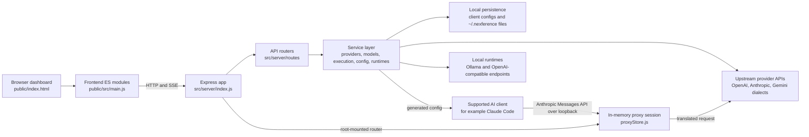
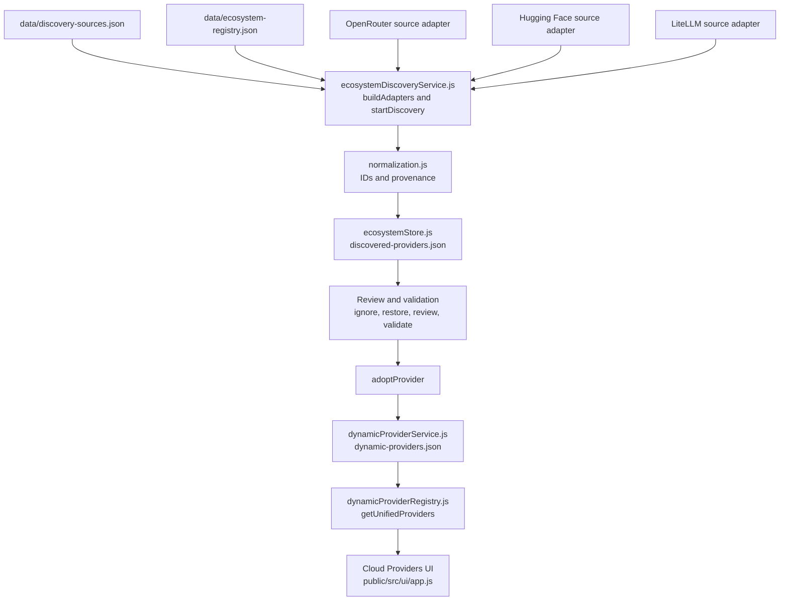
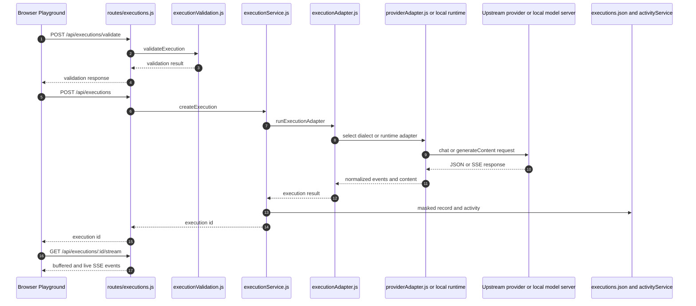
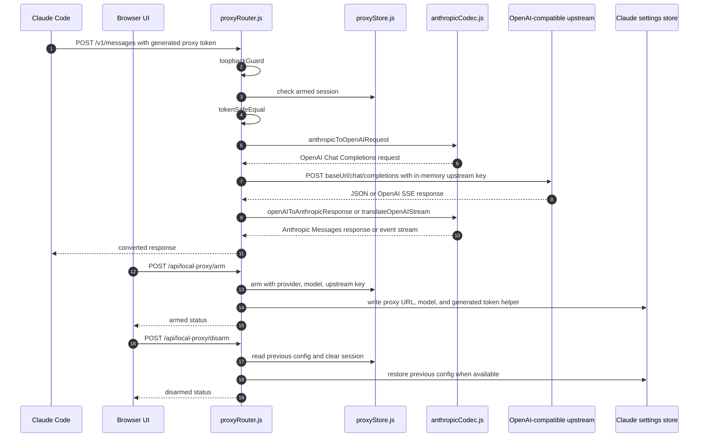
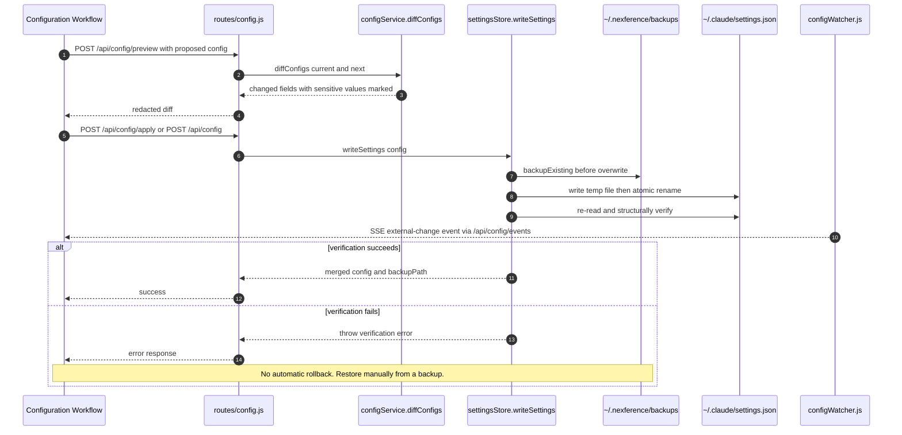
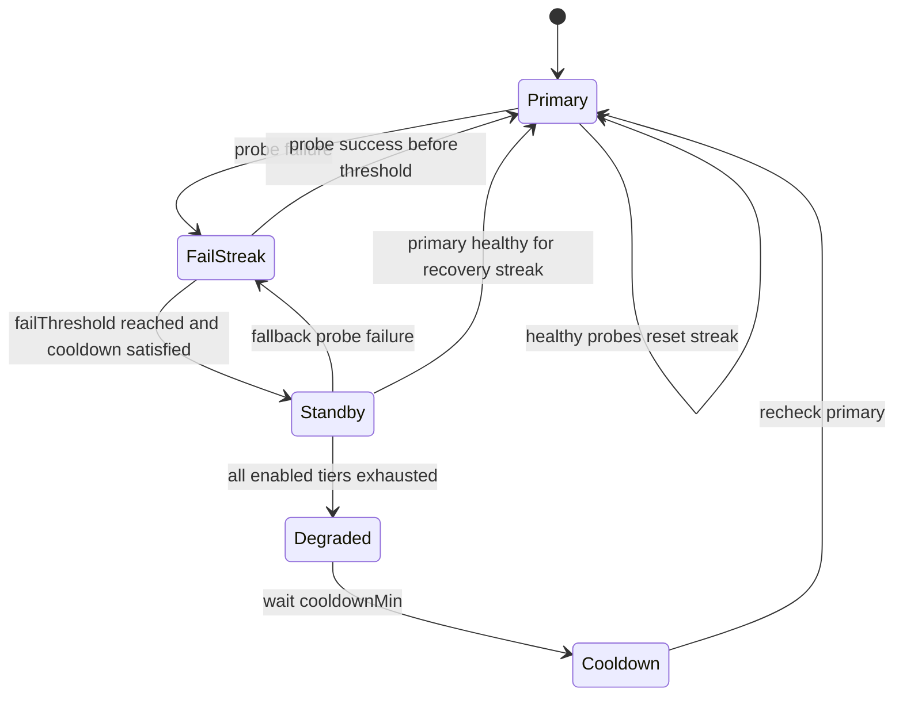
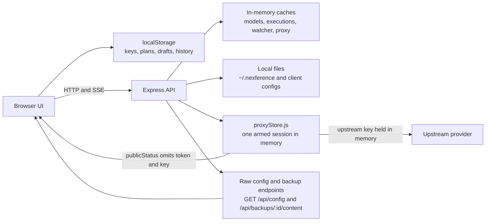

# Nexference v2.4.0 Architecture

This document describes the architecture that is present in the repository at version `2.4.0`, as declared in `package.json`. It is written for developers joining the project, technical reviewers, and future maintainers.

The architecture is described from source inspection, not from release notes or marketing text. Where the implementation is incomplete or internally inconsistent, that is stated explicitly.

## 1. Git safety and initial inspection

Before this document was created, the following baseline was checked:

- `git status --short` reported a clean working tree.
- `git log -5 --oneline` included:
  - `a654f51 fix(ui): harden provider cards and custom gateway workflows`
  - `1ae7ab4 docs: refresh README for v2.4.0`
  - `bd69606 v2.4.0 local proxy, fallback hardening, and discovery`
- `README.md`, `package.json`, the tracked-file inventory, and the repository directory structure were inspected.
- The implementation was inspected directly under `src/server/` and `public/src/`, including route definitions, provider discovery, execution, proxy, configuration, fallback, runtimes, clients, and storage.

No destructive Git commands were used. No application source, README, dependency manifest, lockfile, screenshot, or version value was modified for this task.

## 2. Documentation deliverable and evidence conventions

The single deliverable for this task is `docs/ARCHITECTURE.md`.

The following terms are used throughout:

| Term | Meaning in this document |
|---|---|
| **Implemented** | A code path exists from an entry point through its service layer to its side effect or response. |
| **Partial** | Some layers exist, but support is scoped, gated, or inconsistent with a broader claim. |
| **Source-verified** | Behavior was read directly from source files. |
| **Runtime-tested** | Behavior was exercised in a running application. No runtime testing was performed for this documentation task. |
| **Untested** | No runtime verification was performed. Some paths also contain source-verified defects that would prevent normal operation. |

No real or sample API keys, proxy tokens, or private configuration values are included. Placeholder names such as "provider key" are used without credential values.

## 3. System architecture

### 3.1 Technology and process model

| Layer | Actual implementation |
|---|---|
| Entry point | `server.js` calls `startServer()` from `src/server/index.js`. |
| Server | Node.js with Express 5 (`express@^5.1.0`). `createApp()` builds the app; `startServer()` calls `app.listen(PORT)` with `PORT = 3000`. |
| Frontend | Static HTML/CSS and browser-native JavaScript ES modules under `public/`. There is no React/Vue/TypeScript build step in the repository. |
| Module system | ESM (`"type": "module"` in `package.json`). |
| API | Route modules under `src/server/routes/`, plus the root-mounted local proxy router. |
| Service layer | Provider, model, intelligence, execution, configuration, runtime, client, and activity services under `src/server/`. |
| Persistence | Local files under `~/.nexference/`, client configuration files, and browser `localStorage`. |
| Background work | Curated model refresh every 30 minutes, startup model fetches, startup custom-provider model fetch, logo backfill, and an external config-change watcher. |

`src/server/index.js` serves `public/` with `Cache-Control: no-store...`, accepts JSON bodies up to `5mb` for base64 provider logos, registers all route modules in a fixed order, and then mounts `proxyRouter` at the application root. The main Express listener does not pass a host argument to `app.listen()`; the local proxy router enforces its own loopback guard for its endpoints. The application is intended for local use at `http://localhost:3000`, but the main server should not be treated as internet-hardened.

### 3.2 Frontend composition

`public/index.html` is the static shell. `public/src/main.js` is the composition root:

1. Applies the theme and appearance settings.
2. Registers browser routes through `public/src/core/router.js`.
3. Uses `UI.renderWorkspace`, `UI.renderCloudProviders`, `UI.renderLocalAI`, `UI.renderModels`, `UI.renderClients`, `UI.renderConfiguration`, `UI.renderPlayground`, `UI.renderSettings`, `renderIntelligenceCenter`, and `renderEcosystem` as page renderers.
4. On `DOMContentLoaded`, initializes provider defaults, fetches cached models and provider intelligence, loads configuration, refreshes the provider index, navigates to the stored page, starts the fallback monitor, installs the `nx-fallback` listener, polls for models, and initializes integration/custom-provider actions.
5. Exposes many functions on `window` through its `GLOBALS` object so inline handlers in the static HTML continue to work.

`public/src/core/state.js` holds the mutable `workspace` object; `public/src/core/storage.js` is the typed `localStorage` wrapper. UI code is split across `public/src/ui/`, `public/src/components/`, `public/src/config/`, `public/src/providers/`, `public/src/clients/`, `public/src/runtimes/`, `public/src/models/`, `public/src/playground/`, and `public/src/compatibility/`.

The static Playground markup in `public/index.html` says "Playground coming soon", but that section is replaced at runtime by `UI.renderPlayground()`. The static text is not the runtime state.

### 3.3 Backend request flow

A normal browser request follows this path:

1. A browser page or component calls a relative API endpoint.
2. Express static serving or a router in `src/server/routes/` receives the request.
3. The route validates query/body inputs and calls a service or store.
4. Services resolve providers/models, write or read local files, probe local runtimes, or call upstream HTTP APIs.
5. Responses are returned as JSON or server-sent events (SSE).

The major subsystem responsibilities are:

- `src/server/providers/`: curated, custom, dynamic, ecosystem, integration, and provider intelligence logic.
- `src/server/models/`: unified catalogue, recommendations, detail, and statistics.
- `src/server/execution/`: execution validation, routing, adapters, metrics, records, and gateway library code.
- `src/server/proxy/`: local Anthropic-compatible proxy, codec, and in-memory session.
- `src/server/config/`: Claude/OpenCode/Codex configuration stores, diffing, backup, and watcher.
- `src/server/local/` and `src/server/runtimes/`: local runtime detection, status, and model access.
- `src/server/clients/`: client catalogue, capabilities, and concrete config adapters.
- `src/server/intelligence/`, `src/server/health/`, `src/server/environment/`, `src/server/activity/`, and `src/server/benchmarks/`: observability and reporting.

### 3.4 Diagram 1 - High-level system architecture



## 4. Provider and model discovery architecture

### 4.1 Provider origins

Nexference separates discovery metadata, provider records, integration evidence, and execution support. A discovered provider is not automatically a configurable or executable provider.

| Origin | Source of truth | Lifecycle | Code |
|---|---|---|---|
| Curated | Built-in `PROVIDERS` array | Static registry; active unless excluded by a specific caller | `src/server/providers/registry.js` |
| Custom | User-created records in `~/.nexference/custom-providers.json` | `lifecycle: 'active'` or deactivated; model/integration support starts as unknown/unverified | `src/server/providers/custom/customProviderStore.js`, `customProviderService.js` |
| Discovered | Ecosystem records from configured and programmatic sources | Review states such as ignored, restored, and adopted | `src/server/providers/ecosystem/ecosystemStore.js`, `constants.js` |
| Adopted / dynamic | `~/.nexference/dynamic-providers.json` created from an adopted ecosystem record | `active` or `inactive`; appears in the unified catalogue with `origin: 'ecosystem'` | `src/server/providers/dynamic/dynamicProviderStore.js`, `dynamicProviderService.js`, `dynamicProviderRegistry.js` |

Curated providers are the built-in records `agentrouter`, `aerolink`, `freemodel`, `openrouter`, `nvidia`, `groq`, `gemini`, `cerebras`, `orcarouter`, `mistral`, `huggingface`, `chutes`, and `tokenrouter`. `publicModels`, `pricingApi`, `publicListApi`, `excludeModels`, `bearerAuth`, `scrapeDefaultPaid`, and `openaiCompat` fields describe how each record may be fetched, classified, or proxied.

Custom IDs use the form `cst:<slug>-<base36 timestamp>`. Adopted dynamic IDs use the form `dyn:<slug>`. Ecosystem IDs use the form `ecosys:<sourceId>:<tokenized seed>`.

Active and inactive states apply to managed records: an inactive custom or dynamic provider can be stored without being treated as currently available. A discovered record's registry state is separate from its source evidence and from its integration status.

### 4.2 Discovery sources and service

`src/server/providers/ecosystem/ecosystemDiscoveryService.js` combines:

- Configured sources from `data/discovery-sources.json`, including the community registry backed by `data/ecosystem-registry.json`.
- Programmatic adapters for OpenRouter, Hugging Face, and LiteLLM.

`buildAdapters()` maps enabled configured records through `createStructuredRegistrySource()` and adds the programmatic adapters. `startDiscovery()` is in-flight guarded and returns `already_running` if a job is active. Progress is exposed by `GET /api/ecosystem/discover/status`.

Discovery persistence is in `src/server/providers/ecosystem/ecosystemStore.js`:

- `discovered-providers.json`
- `discovery-history.json`
- `discovery-sources-state.json`

Discovery history is capped at 100 records. Source-verified freshness values are `FRESH_MS = 7 days`, `VALIDATION_TTL_MS = 12h`, `LOGO_TTL_MS = 7d`, and `LOGO_MISS_TTL_MS = 24h`.

Normalization and provenance live in `normalization.js`, `constants.js`, and the evidence/integration modules. The code deliberately keeps missing fields as unknown or null and flags similar names instead of merging them.

### 4.3 Model fetching, normalization, and classification

Curated model fetching is implemented in `src/server/providers/modelService.js`. `fetchModelsForProvider()` uses this order:

1. Live provider `/models`-style API with format-specific authentication.
2. Official public list endpoint from `publicListApi`.
3. Public `pricingApi`.
4. Website scrape via `PROVIDER_SITES` and `SCRAPE_PARSERS`.
5. If all live sources fail, store zero models and return an honest failure.

`STATIC_MODELS` in `src/server/providers/registry.js` is used only as a paid-flag overlay on models that were actually fetched. It is not a model-name fallback, despite a stale comment in `modelService.js` that describes four tiers including a static list.

The in-memory cache is `modelCache` in `src/server/providers/modelCache.js`:

- `FETCH_INTERVAL = 30 * 60 * 1000`
- `FETCH_TIMEOUT = 15000`

`fetchAllModels(source = 'startup')` iterates curated providers except `anthropic`. `src/server/index.js` calls it at startup and on the periodic interval. Custom-provider model fetching is startup-only in the background plus route-triggered refreshes; `fetchCustomProviderModelsBackground()` runs before logo backfill because both jobs upsert the same custom-provider records.

Free/paid classification is shared through `src/server/providers/modelClassifier.js`. Explicit zero pricing, `accessType === 'free'`, and whole-token `free` markers in model IDs or names can classify a model as free. Unknown prices are not invented as free or paid.

Custom-provider discovery in `src/server/providers/custom/customModelFetch.js` attempts pricing and sitemap signals, official `/models` with a transient key, a keyless pricing catalogue, sitemap/storefront overlays, storefront rows, and strict website scraping before returning a failure. The UI-supplied key is request-scoped and is not persisted by this pipeline.

The unified catalogue is assembled by `getUnifiedProviders()` in `dynamicProviderRegistry.js` and `getUnifiedModels()` in `src/server/models/modelIntelligenceService.js`. `GET /api/models` uses the unified catalogue unless a `url` query is present, in which case it falls back to the legacy URL-based live-fetch behavior. This is distinct from the local Anthropic-compatible proxy described in section 6.

### 4.4 Adoption and integration

`adoptProvider()` in `ecosystemDiscoveryService.js` changes the ecosystem record state and calls `createDynamicFromEcosystem()`. On success it stores a `dynamicId` on the discovered record. Adoption is idempotent and refuses to duplicate a curated provider. `discoverDynamicModels()` first attempts a real gateway probe when a dynamic record has `integration.baseUrl`, then falls back to the discovery snapshot.

Integration assessment lives under `src/server/providers/integrations/`:

- Statuses: `integrated`, `supported`, `partial`, `assessing`, `metadata-only`, `unsupported`, `blocked`, `unknown`.
- Adapter types: `openai-compatible`, `anthropic-compatible`, `gemini-compatible`, `custom`, `none`, `unknown`.
- `isExecutable(status)` is true only for `integrated`, `supported`, and `partial`.
- `resolveAdapter()` combines evidence claims, declared compatibility flags, previous assessments, and curated provider format.
- `providerIntegrationService.js` performs manual, in-flight-guarded assessments and uses transient credentials for test/model calls.

Integration records are stored in `~/.nexference/provider-integrations.json` with secret-shape validation and atomic writes.

### 4.5 Diagram 2 - Provider discovery and adoption flow



### 4.6 Source-verified limitations

- `POST /api/ecosystem/sources/:id/refresh` validates the source ID but then runs a full forced discovery job, not a source-specific refresh.
- Provider-intelligence refresh defines `TTL_MS` and accepts `force`, but those freshness controls are not applied inside `discoverProvider()`.
- Curated Gemini's native `baseUrl` contains a `generativalanguage` host typo, while its declared `openaiCompat.baseUrl` uses `generativelanguage`; the local proxy uses the OpenAI-compatible declaration.
- Two adapter vocabularies coexist: execution formats are `openai|anthropic|gemini`, while integration adapter types are `openai-compatible|anthropic-compatible|gemini-compatible`.

## 5. Execution Gateway architecture

### 5.1 Active route-facing execution path

The route-facing playground execution path is implemented by `src/server/routes/executions.js`, `src/server/execution/executionService.js`, `executionValidation.js`, `executionAdapter.js`, `executionMetrics.js`, and `src/server/providers/providerAdapter.js`.

The browser selection comes from `public/src/core/state.js` and `public/src/core/storage.js`. `public/src/playground/playgroundService.js` creates requests from the selected source, provider, runtime, model, prompt, and parameters; for cloud execution it reads the key from `Storage.getKey(providerId)` and sends it with the request to the local server.

The active backend flow is:

1. `POST /api/executions/validate` calls `validateExecution()`.
2. `POST /api/executions` calls `createExecution()`.
3. Executions are queued sequentially in `executionService.js`.
4. `runExecutionAdapter()` selects:
   - Cloud: `getProviderAdapter().chat()` using OpenAI, Anthropic, or Gemini dialect.
   - Local: Ollama native `/api/chat`, or OpenAI-compatible `/v1/chat/completions`.
5. `computeMetrics()` records only measurable values; unavailable token counts stay `null`.
6. History and activity records are written, with secrets masked.
7. SSE subscribers receive buffered lifecycle events through `GET /api/executions/:id/stream`.

Execution records are stored in `~/.nexference/executions.json`, capped at 100. Measured benchmark results are stored in `~/.nexference/benchmarks.json`, capped at 200. The default execution timeout is `180000` ms.

### 5.2 Gateway resolver and bridges

`src/server/execution/executionResolver.js` defines:

- `LEGACY_PROVIDER_BRIDGE`
- `INTEGRATION_ADAPTER_BRIDGE`
- `RUNTIME_EXECUTION_BRIDGE`
- `UNSUPPORTED`

`resolveExecutionRoute()` checks local runtimes against `RUNTIME_EXEC`, then resolves cloud providers through `getExecutableProvider()`. `executionGateway.js` exposes `gatewayExecute()` and normalizes errors through `executionErrors.js`.

The bridges are:

- `runtimeExecutionBridge.js`: probes the runtime, then delegates to `runExecutionAdapter()`.
- `legacyProviderBridge.js`: wraps `getProviderAdapter().chat()`.
- `integrationAdapterBridge.js`: checks integration status and capabilities, then still delegates the HTTP call to `providerAdapter.js`.
- `unsupported` paths return a categorized error rather than fabricating execution.

`EXEC_FORMATS` is `['openai', 'anthropic', 'gemini']`. `RUNTIME_EXEC` declares real execution contracts for Ollama, LM Studio, vLLM, SGLang, and llama.cpp with their well-known local ports; reachability is checked at request time.

### 5.3 Request, response, and error handling

Cloud adapters in `providerAdapter.js`:

- OpenAI-compatible: `chat/completions` with `Authorization: Bearer ...`.
- Anthropic-compatible: `messages`, with `x-api-key`, `Authorization: Bearer ...`, and `anthropic-version`.
- Gemini: `generateContent` or `streamGenerateContent`, with the key in the query string.

Each dialect has its own SSE reader. Local execution uses the Ollama newline-JSON protocol or OpenAI-compatible SSE.

`executionErrors.js` classifies errors into normalized categories and masks secrets before returning `{ category, message, userMessage, route, timestamp }`. Client cancellation and disconnect handling are implemented in `executionService.js`; late SSE subscribers receive buffered events.

### 5.4 Diagram 3 - Execution Gateway sequence



### 5.5 Source-verified limitations

- `gatewayExecute()` exists in `executionGateway.js`, but `routes/executions.js` imports the v0.9 `executionService.js` path instead. The v2 gateway library is not the active route-facing execution path.
- `getExecutionCapabilitiesFull()` and `getExecutionCoverage()` are used by capability endpoints; `getGatewayCapabilities()` and `getGatewayCoverage()` are not the route-facing implementations.
- `resolveCloudRoute()` accepts a `key` parameter but does not use it; `resolveExecutionStatus()` does use key presence to distinguish `needs_credentials` from `ready`.
- `integrationAdapterBridge.js` reads `integration.integrationAdapterType`, while persisted integration records use `adapterType`. This is latent while the gateway library is not route-wired.
- `gatewayExecute()` imports normalized result helpers but returns raw bridge results; normalized errors are added, while normalized result construction is not applied in that function.
- `POST /api/custom-providers/:id/test` treats any non-Anthropic format, including Gemini, as OpenAI-compatible.
- Integration support does not imply full feature parity. Model listing, streaming, custom headers, and environment-variable support differ by concrete adapter.

## 6. Local proxy architecture

### 6.1 Purpose and scope

The local proxy exists because Claude Code speaks the Anthropic Messages API shape while many providers expose OpenAI-compatible APIs. It is separate from the general execution gateway: the proxy is a long-running loopback translation endpoint for a supported Claude Code workflow, while the execution gateway handles playground-style server-side runs.

Primary source files:

- `src/server/proxy/proxyRouter.js`
- `src/server/proxy/proxyStore.js`
- `src/server/proxy/anthropicCodec.js`
- `public/src/localProxy.js`
- `public/src/ui/customProvider.js`
- `public/src/components/providerConfig.js`

The proxy exposes:

| Method | Endpoint | Purpose |
|---|---|---|
| `POST` | `/v1/messages` | Anthropic-compatible Messages endpoint translated to an OpenAI-compatible upstream. |
| `GET` | `/v1/models` | Returns the currently armed model. |
| `POST` | `/api/local-proxy/arm` | Arms the in-memory session and points Claude Code at the proxy. |
| `GET` | `/api/local-proxy/status` | Reports status and orphaned-settings detection. |
| `POST` | `/api/local-proxy/disarm` | Disarms and restores the captured previous Claude config when available. |

### 6.2 Authentication and loopback enforcement

`loopbackGuard()` is applied to the entire proxy router. It accepts loopback forms such as `127.0.0.1`, `::1`, expanded IPv6 loopback, and `localhost`, and returns HTTP 403 for other callers.

Token authentication applies only to `/v1/*` endpoints:

- The token may be supplied in `x-api-key` or `Authorization: Bearer ...`.
- `tokenSafeEqual()` uses `crypto.timingSafeEqual`.
- A request received while the proxy is not armed returns HTTP 503.
- A bad or missing token returns HTTP 401.

The management endpoints are loopback-only but have no token authentication; any local process can call them. The main Express server is not host-restricted by `app.listen(PORT)`, so Nexference as a whole must not be exposed to untrusted networks.

### 6.3 Translation

`anthropicToOpenAIRequest()` converts supported Anthropic request fields, including text, image URL/data URL content, tools, tool choice, tool results, `max_tokens`, `temperature`, `top_p`, and `stop_sequences`. Streaming requests set `stream_options.include_usage = true`.

`openAIToAnthropicResponse()` converts non-streaming responses. `translateOpenAIStream()` converts OpenAI-style SSE into Anthropic events including `message_start`, `content_block_start`, `content_block_delta`, `content_block_stop`, `message_delta`, and `message_stop`.

Tool calls and tool results are translated for the supported path. Extended thinking is degraded rather than rejected: `thinking` and `redacted_thinking` blocks are dropped, and the non-streaming response adds `X-Nexference-Thinking: dropped`. This changes answer behavior, not response shape. `/v1/messages/count_tokens` and model aliasing are explicitly out of scope in the codec; there is no dedicated `count_tokens` route.

Only OpenAI-format providers may be armed. Curated Gemini is accepted through its declared `openaiCompat.baseUrl`, so it is handled as an OpenAI-compatible surface, not a native Gemini proxy path. The proxy resolves `dyn:` and `eco:` dynamic IDs, `cst:` custom IDs, and curated IDs through `resolveProvider()`.

### 6.4 Session lifecycle and credential handling

`proxyStore.js` supports exactly one active session. `arm()` generates a token with `randomBytes(24).toString('hex')` and keeps the token, upstream key, provider metadata, model, arming time, and previous Claude config in memory. `publicStatus()` omits both the token and upstream key.

Arming captures the pre-proxy Claude settings and writes a minimal config containing:

- `env.ANTHROPIC_BASE_URL` pointed at the loopback proxy.
- `env.ANTHROPIC_MODEL`.
- `env.CLAUDE_CODE_DISABLE_NONESSENTIAL_TRAFFIC = 1`.
- `apiKeyHelper` containing the generated proxy token.
- `model`.

The upstream provider key is not written into that generated Claude config; it stays in the in-memory proxy session. Provider keys may still exist separately in browser `localStorage` because that is the existing frontend credential store.

Disarm restores the captured previous config when one exists. A server restart clears the in-memory session; `GET /api/local-proxy/status` reports `settingsOrphaned` when Claude settings still point at the loopback proxy while no armed session exists.

Error mapping in `proxyRouter.js` maps upstream 401 to `authentication_error`, 403 to `permission_error`, 429 to `rate_limit_error`, 400/404/422 to `invalid_request_error`, other non-5xx responses to 502, and passes 5xx responses through. Upstream error text is condensed and capped. Client disconnects abort the upstream request and return 499 when the response is still writable; stream failures are emitted as Anthropic `error` events.

### 6.5 Mermaid diagram 4 — local proxy sequence



### 6.6 Source-verified limitations and caveats

- This is not a complete Anthropic API implementation. Only the codec paths needed by the supported Claude Code workflow are implemented.
- Not every provider is proxy-compatible. Arming requires an OpenAI-compatible format or a declared compatible surface, a valid `http`/`https` base URL, and a resolvable provider ID.
- Only one active proxy session is supported.
- The session, generated token, and upstream key are memory-only; a restart requires re-arming.
- Management endpoints are loopback-guarded but not token-authenticated.
- The generic Custom Gateway has frontend ID `custom`, but `resolveProvider()` has no bare `custom` branch and no curated server provider with that ID. Source inspection indicates generic Custom Gateway proxy arming fails with `Unknown provider: custom`; `cst:`, `dyn:`, and `eco:` IDs are supported.
- The fallback proxy-switching path has a response-shape mismatch documented in section 8.
- No runtime proxy translation test was performed for this document.

## 7. Claude Code configuration safety

### 7.1 Configuration ownership

Claude Code configuration is owned by the protected frontend generation logic and the server-side settings store. `src/server/config/settingsStore.js` defines:

- `SETTINGS_PATH` as `~/.claude/settings.json`.
- `BACKUP_DIR` as `~/.nexference/backups/`.

`normalize(config)` deliberately writes only:

- `env`
- `apiKeyHelper`
- `model`

The frontend config engine produces a fully formed config; the server layer normalizes partial payloads into that minimal shape. This document does not modify the existing engine, adapter, template, or related protected implementation.

### 7.2 Preview and redacted diff

The configuration workflow is orchestrated by `public/src/config/workflow.js`. Its review step calls:

- `POST /api/config/preview` for Claude Code.
- `POST /api/config/:clientId/preview` for other clients.

`diffConfigs()` in `src/server/config/configService.js` compares current and proposed configs and returns a flat field list. Sensitive fields are represented only by presence state:

- `apiKeyHelper`
- `env.*` keys containing `key`, `token`, or `helper`
- `provider.*.options.apiKey`
- `model_providers.*.env_key`

The UI renders sensitive values as `••• set`. `maskConfigForPreview()` and `maskConfigForView()` are display-only helpers; they do not change what is stored or what raw endpoints return.

The external-change watcher uses a 300 ms debounce plus a 2-second polling fallback and publishes events through `GET /api/config/events`. `getConfigStatus()` aggregates file status, external-change state, backup list, and provider test metadata.

### 7.3 Backup, atomic write, and verification

`writeSettings()` in `settingsStore.js` implements the write path:

1. Validate that the payload is an object.
2. Create the parent directory if needed.
3. Normalize to `env`, `apiKeyHelper`, and `model`.
4. Back up an existing config to a timestamped `claude-settings-<timestamp>.json` file. A backup failure aborts the write.
5. Write a sibling temporary file.
6. Rename it atomically with `atomicRenameSync()` from `src/server/utils/fs.js`.
7. Re-read the final file and structurally compare `model`, `apiKeyHelper`, and `env`.
8. Return `{ merged, backupPath }` on success.

`restoreBackup(id)` in `src/server/config/backupStore.js` reads a validated backup and calls `writeSettings()`, so a restore also creates a safety backup first. Backup IDs are sanitized by `safeId()`, and bulk deletion is capped at 200 IDs.

Proxy disarm restores the config captured at arm time through the same settings store path when a previous config exists.

### 7.4 Verification-failure behavior

The intended pipeline is:

```text
Preview -> Diff -> Backup -> Atomic Write -> Verified Re-read -> Restore
```

The actual failure behavior must be read carefully:

- Verification happens **after** the atomic rename.
- If verification fails, `writeSettings()` throws and the API returns an error, but there is no automatic rollback code that rewrites the previous config.
- A timestamped backup exists and manual restoration is available through `POST /api/backups/:id/restore` or the backup UI.
- Proxy arm failure handling calls `store.disarm()` but does not rewrite `previousConfig` after a failed write.

Therefore "Restore on failure" means a manual restore path is available, not automatic rollback.

### 7.5 Mermaid diagram 5 — Claude configuration apply sequence



### 7.6 Security caveats

- Direct non-proxy Claude Code applies can write a provider key into `~/.claude/settings.json`; backups of that file can contain the same value.
- `GET /api/config` returns `{ config, path, raw }` from the settings store without server-side masking.
- `GET /api/backups/:id/content` returns raw backup config.
- Generated configs and backups should be treated as sensitive local files.
- Apply behavior for other clients differs; do not assume identical safeguards for every client path.

## 8. Fallback and recovery architecture

### 8.1 Plan storage and defaults

Fallback is a browser-side workflow. There is no dedicated backend fallback route or server-side fallback store. Plans and monitor state are stored in `localStorage` by `public/src/config/fallbackStore.js`:

- Master key: `nx_fallback_enabled`.
- Per-client key: `nx_fallback_<clientId>`.
- Plan shape: `v`, `enabled`, `primary`, `tiers`, `knobs`, `state`.
- Defaults:
  - `DEFAULT_TIERS = 2`
  - `MAX_TIERS = 5`
  - `failThreshold = 2`, clamped to 1–5
  - `cooldownMin = 5`, clamped to 1–60
  - `autoRevert = true`
  - `activeTier = 0`
  - `failStreak = 0`
  - `lastSwitchAt = 0`
  - `degraded = false`

Plans store provider/model references only; they do not store API keys. Credentials are still read from the existing `gw_key_<id>` browser store when probing.

### 8.2 Monitor design

`public/src/config/fallbackMonitor.js` is started from `public/src/main.js` when the dashboard loads. Its stated constraints are that it runs only while a tab is open and pauses switching while an external config change is pending.

Source-verified monitor values:

- `TICK_MS = 60000`
- `RECOVERY_STREAK = 2`

The design uses:

- `probeTarget()` and `probeTier()` with `GET /api/test` and `Storage.getKey()`.
- `buildTargets()` to order the primary and enabled tiers.
- `switchTo()` to reapply the proven config path through `configForSelection()` and `LocalSettingsRuntime.write()`.
- `GET /api/config/status` as the external-change guard for Claude Code.
- `needsProxy()` and `probeViaProxyUrl()` for OpenAI-only Claude Code tiers, which route through `armLocalProxy()`.
- Manual "Test now" through `probeTier()` from `public/src/ui/fallbackUI.js`.

The source intent is primary-first behavior: leave the primary only after repeated real failures, check the primary before descending further, revert after a healthy streak when `autoRevert` is enabled, and mark the client degraded if all tiers fail.

### 8.3 Mermaid diagram 6 — fallback state lifecycle



### 8.4 Source-verified defects and limits

- In `tickFallbackMonitor()`, `res.ok` is referenced at lines 277, 293, and 319 without an in-scope `res` assignment. Source inspection indicates an enabled plan with targets would raise `ReferenceError`; `startFallbackMonitor()` swallows errors with `.catch(() => {})`, so ticks may fail silently. This was not runtime-tested.
- `armLocalProxy()` in `public/src/localProxy.js` returns `{ ok, status, data }`, but `switchTo()` checks `r.armed` and reads `r.error`. A successful proxy arm would therefore be treated as a failure by that source path.
- Monitoring depends on an open Nexference dashboard tab. Closing the dashboard stops active detection and leaves the last written config in place.
- There is no zero-downtime or guaranteed-recovery claim. Auth failures, rate limits, model removal, upstream outages, and unsupported request shapes can still fail.
- Manual tier testing calls `probeTier()` directly and is separate from the defective automatic tick path.

## 9. Local runtimes and client architecture

### 9.1 Runtime catalogue and detection

Server runtime catalogue code is in `src/server/local/runtimes.js`. It lists Ollama, LM Studio, llama.cpp, vLLM, SGLang, KoboldCpp, and Jan.

| Runtime | Server capability in source | Limitation |
|---|---|---|
| Ollama | Real `/api/tags` detection, model listing, native execution, and allowlisted start commands. | No stop implementation. |
| LM Studio | Detection and OpenAI-compatible execution contract; allowlisted start command via `lms server start`. | Start reports "Starting..." without the same reachability verification used for Ollama. Frontend marks it planned; server does not. |
| llama.cpp | OpenAI-compatible execution contract on port 8080. | No dedicated model discovery or managed start path. Frontend marks it planned; server does not. |
| vLLM | OpenAI-compatible execution contract on port 8000. | No dedicated model discovery or managed start path. Frontend marks it planned; server does not. |
| SGLang | OpenAI-compatible execution contract on port 30000. | No dedicated model discovery or managed start path. Frontend marks it planned; server does not. |
| KoboldCpp | Catalogue entry only. | `planned: true`; no real adapter. |
| Jan | Catalogue entry only. | `planned: true`; no real adapter. |

`detectRuntimes()` probes Ollama and uses `RUNTIME_EXEC` for OpenAI-compatible detection. `probeRuntime()` checks `/api/tags` for Ollama or `/models` for OpenAI-compatible runtimes. `startRuntime()` accepts only fixed, allowlisted commands; arbitrary shell input is not accepted. No runtime stop operation is implemented.

LM Studio model discovery uses `lms ls --json` only when the local server is already running; otherwise it scans filesystem locations. Other runtimes do not have equivalent model discovery. `/api/runtimes/:id/models` currently returns Ollama models only.

### 9.2 Runtime inconsistencies

- `public/src/runtimes/base.js` calls `GET /api/local/runtimes`, but no backend route with that path is registered. The registered routes are `/api/local-runtimes` and `/api/runtimes`; the main UI uses the former.
- `/api/local-runtimes` can detect OpenAI-compatible runtimes, while `/api/runtimes` uses `getRuntimeStatus()` from `src/server/runtimes/runtimeAdapter.js`, which only probes Ollama and marks other runtimes `detectionMethod: 'none (planned)'`.
- `public/src/runtimes/registry.js` marks LM Studio, llama.cpp, vLLM, and SGLang as planned, while `src/server/local/runtimes.js` marks them `planned: false`.
- Command-palette actions in `public/src/components/commandPalette.js` look for `.chip-filter.reg[data-reg="adopted"]` and `.chip-filter.reg[data-reg="custom"]`, but `renderCloudProviders()` renders a `<select data-reg-select>` with options. Those actions are effectively no-ops.
- `renderPlayground()` passes `initialModel` to `openWorkflow()`, but `openWorkflow()` does not read it; the wizard falls back to `Storage.getModel(provider)`.

### 9.3 Client registry and capability levels

`src/server/clients/registry.js` defines three integration levels:

1. **Native Managed**: read, generate, apply, and backup supported.
2. **Assisted Setup**: guidance or a config snippet, but no promise of automatic write.
3. **Detection Only**: the client can be detected or catalogued, but not configured.

| Client | Registry level | Actual source behavior |
|---|---:|---|
| Claude Code | 1 | Full managed workflow. `ClaudeCodeAdapter` reads and writes through the settings store. |
| OpenCode | 2 | Concrete read/apply/validate/backup/restore adapter exists in `clientAdapter.js`, using `~/.config/opencode/opencode.json`, but registry and frontend capability labels lag behind. |
| Codex CLI | 2 | Concrete read/apply/validate/backup/restore adapter exists, using `~/.codex/config.json`, but labels remain manual/assisted. |
| Gemini CLI | 2 | Registry/guidance entry only; no concrete adapter is mapped. |
| Antigravity CLI | 3 | Detection/catalogue entry. |
| Cursor | 3 | Detection/catalogue entry; no automatic configuration. |

`getClientAdapter()` maps only `claude-code`, `opencode-cli`, and `codex`. For any other registered client it falls back to the base `ClientAdapter`, whose `readConfig()` and `applyConfig()` delegate to Claude settings while `getConfigLocation()` returns the client's advertised path. Source inspection therefore indicates that `/api/config/gemini-cli` could report a Gemini CLI path while reading or writing Claude settings. Unsupported clients should not be treated as safely configurable through that generic path.

Only Claude Code has the complete managed apply flow that is represented in the main configuration UI. OpenCode and Codex have real server adapters, but their frontend visibility/capability metadata does not fully expose that. Gemini CLI, Antigravity CLI, and Cursor are registry, detection, or guidance entries rather than fully managed configuration targets.

## 10. Data storage and security architecture

### 10.1 Browser storage

`public/src/core/storage.js` is the typed `localStorage` wrapper. Important keys include:

| Key family | Stored data | Security note |
|---|---|---|
| `gw_key_<id>` | Raw provider API key | Plaintext browser-local state; not a hardened secret store. |
| `gw_baseurl_<id>`, `gw_model_<id>`, `gw_paid_<id>`, `gw_custom_format` | Provider selection and custom format | Non-secret selection state. |
| `nx_page`, `nx_theme`, `nx_accent`, `nx_density`, `nx_motion`, `nx_sidebar`, `nx_intel_period` | UI and appearance preferences | Cosmetic/navigation state. |
| `nx_profiles`, `nx_profile_<id>`, `nx_applied` | Profiles and applied metadata | Designed as references, not credential storage. |
| `nx_wf_draft` | Configuration wizard draft | May contain generated config in `lastConfig`, including sensitive values. |
| `nx_fallback_enabled`, `nx_fallback_<clientId>` | Fallback master switch and per-client plans | References and knobs only, no API keys. |
| `pg_draft_v1`, `nx_pg_active`, `nx_recent_models` | Playground draft and recent model state | Prompt text may be present; no credential field is defined. |
| `nexference_custom_gateway_history_v1` | Gateway History | Stores `{ format, baseUrl, model, ts }`, capped at 20; no API key field. |
| `nx_activity` | Browser activity display cache | Treat displayed content as potentially sensitive. |

The `nx_wf_draft` caveat is important: source comments say the draft contains no API keys, but `saveDraft()` persists `lastConfig`, and generated configs can embed keys in `apiKeyHelper`, `env.ANTHROPIC_AUTH_TOKEN`, `OPENAI_API_KEY`, or `GOOGLE_API_KEY`. Preview masking is display-only.

### 10.2 Server-side filesystem storage

All paths below are under the local user's home directory unless noted:

| Path or directory | Owner | Contents |
|---|---|---|
| `~/.claude/settings.json` | Claude Code / settings store | Managed Claude config. |
| `~/.nexference/backups/` | `settingsStore.js` | Timestamped Claude settings backups. |
| `~/.nexference/backups/opencode/`, `~/.nexference/backups/codex/` | Client config stores | Client-specific backups. |
| `~/.nexference/custom-providers.json` | `customProviderStore.js` | Custom provider records and cached model metadata. |
| `~/.nexference/dynamic-providers.json` | `dynamicProviderStore.js` | Adopted provider records. |
| `~/.nexference/discovered-providers.json`, `discovery-history.json`, `discovery-sources-state.json` | `ecosystemStore.js` | Discovery records, provenance, and source state. |
| `~/.nexference/provider-intelligence.json`, `provider-history.json`, `provider-changes.json`, `provider-metrics.json`, `provider-integrations.json`, `provider-benchmarks.json` | Provider services | Intelligence, history, change, metric, integration, and benchmark metadata. |
| `~/.nexference/activity.json` | `activityService.js` | Activity events. |
| `~/.nexference/executions.json`, `benchmarks.json` | `executionService.js` | Execution and measured benchmark history. |
| `~/.nexference/profiles.json` | `profileStore.js` | Saved profiles. |
| `~/.nexference/provider-tests.json` | `credentialsStore.js` | Test metadata, not raw provider secrets. |

In-memory state includes `modelCache` in `modelCache.js`, active executions in `executionService.js`, external-change state in `configWatcher.js`, and the armed proxy session in `proxyStore.js`.

### 10.3 Mermaid diagram 7 — data storage and security flow



### 10.4 Security caveats

- The app is intended for trusted local use. The main Express listener is not host-bound to loopback in `src/server/index.js`; only the proxy router applies its own loopback guard.
- Proxy `/v1/*` requests use loopback enforcement and constant-time token comparison. Management endpoints are loopback-only but unauthenticated.
- Proxy status responses deliberately omit the generated token and upstream key.
- The upstream key lives only in `proxyStore.js` during an active session. Provider keys entered elsewhere may still live in browser `localStorage`.
- `gw_key_<id>` stores raw provider API keys in plaintext browser state. Any script or extension running on the app origin may be able to read them.
- `nx_wf_draft.lastConfig` may contain generated config with sensitive values.
- `GET /api/config` and `GET /api/backups/:id/content` return raw configuration content. `GET /api/test` and `GET /api/executions/status/:providerId` accept keys in query strings.
- Gateway History stores no API keys. Execution history masks errors and stores summaries, but those summaries can include prompt/content previews and parameters.
- Config backups reduce risk; they are not version control and do not guarantee recovery.
- No complete encryption, isolated secret vault, or internet-facing authorization model is implemented. Do not expose Nexference or its proxy to untrusted networks.

## 11. Project structure

The following tree contains the actual top-level directories and important source areas. Dependency directories are omitted.

```text
.
├── LICENSE
├── README.md
├── package.json
├── package-lock.json
├── server.js
├── nexference-mark.svg
├── data/
│   ├── discovery-sources.json
│   └── ecosystem-registry.json
├── docs/
│   ├── ARCHITECTURE.md
│   └── screenshots/
├── public/
│   ├── index.html
│   ├── style.css
│   ├── brand/
│   ├── clients/
│   ├── providers/
│   └── src/
│       ├── main.js
│       ├── localProxy.js
│       ├── clients/
│       ├── compatibility/
│       ├── components/
│       ├── config/
│       ├── core/
│       ├── design/
│       ├── models/
│       ├── playground/
│       ├── providers/
│       ├── runtimes/
│       └── ui/
└── src/
    └── server/
        ├── index.js
        ├── activity/
        ├── benchmarks/
        ├── clients/
        ├── config/
        ├── environment/
        ├── execution/
        ├── health/
        ├── intelligence/
        ├── local/
        ├── models/
        ├── profiles/
        ├── providers/
        ├── proxy/
        ├── routes/
        ├── runtimes/
        └── utils/
```

Directory responsibilities:

| Directory | Responsibility |
|---|---|
| `data/` | Checked-in discovery source configuration and ecosystem registry data. |
| `docs/screenshots/` | Existing README screenshots; not modified for this task. |
| `public/` | Static shell, CSS, brand/client/provider assets, and frontend ES modules. |
| `public/src/core/` | Router, state, storage, theme, and notifications. |
| `public/src/config/` | Configuration workflow, engine, runtime adapter, fallback store, and fallback monitor. |
| `public/src/ui/` and `public/src/components/` | Page renderers and reusable UI/components. |
| `public/src/playground/` | Playground service, request building, and local draft/history. |
| `src/server/routes/` | Express route registration; authoritative API endpoint definitions. |
| `src/server/providers/` | Curated, custom, dynamic, ecosystem, integration, and provider intelligence services. |
| `src/server/models/` | Unified model catalogue and enrichment. |
| `src/server/execution/` | Validation, routing, adapters, metrics, records, and gateway library code. |
| `src/server/proxy/` | Local proxy router, codec, and in-memory session store. |
| `src/server/config/` | Config stores, diffing, backups, and external-change watcher. |
| `src/server/local/` and `src/server/runtimes/` | Runtime detection, status, start, and model access. |
| `src/server/clients/` | Client registry, adapters, and compatibility checks. |
| `src/server/intelligence/`, `health/`, `environment/`, `activity/`, `benchmarks/` | Observability and reporting services. |
| `src/server/utils/` | Shared filesystem helpers such as atomic rename. |

## 12. API architecture

The following endpoints were checked against route definitions. They are representative of the major groups; this section does not invent request or response schemas. Where a route file mounts a router at `/api`, the final paths are shown.

### 12.1 Providers, models, discovery, and integrations

| Group | Endpoints | Source |
|---|---|---|
| Providers | `GET /api/providers`, `GET /api/providers/:id`, `GET /api/providers/:id/models`, `GET /api/providers/:id/test`, `POST /api/providers/:id/test` | `src/server/routes/providers.js` |
| Models | `GET /api/cached-models`, `POST /api/refresh-models`, `GET /api/models`, `GET /api/models/detail`, `GET /api/models/recommended`, `GET /api/models/stats`, `POST /api/models/refresh` | `src/server/routes/models.js` |
| Custom providers | `GET /api/custom-providers`, `GET /api/custom-providers/:id`, `POST /api/custom-providers`, `POST /api/custom-providers/validate`, `PATCH /api/custom-providers/:id`, `DELETE /api/custom-providers/:id`, `GET /api/custom-providers/:id/fetch-models`, `POST /api/custom-providers/:id/test`, plus logo, favicon, scrape, duplicate, and lifecycle routes | `src/server/routes/customProviders.js` |
| Adopted providers | `GET /api/dynamic-providers`, `GET /api/dynamic-providers/:id`, `POST /api/dynamic-providers/:id/refresh-metadata`, `POST /api/dynamic-providers/:id/discover-models`, `POST /api/dynamic-providers/:id/test`, `PATCH /api/dynamic-providers/:id`, `DELETE /api/dynamic-providers/:id` | `src/server/routes/dynamicProviders.js` |
| Ecosystem discovery | `GET /api/ecosystem/sources`, `GET /api/ecosystem/providers`, `POST /api/ecosystem/discover`, `GET /api/ecosystem/discover/status`, `POST /api/ecosystem/providers/:id/adopt`, `POST /api/ecosystem/providers/:id/validate`, `POST /api/ecosystem/providers/:id/fetch-models`, `GET /api/ecosystem/summary` | `src/server/routes/ecosystem.js` |
| Integrations | `GET /api/provider-integrations`, `GET /api/provider-integrations/coverage`, `POST /api/provider-integrations/assess`, `POST /api/provider-integrations/:providerId/test`, `POST /api/provider-integrations/:providerId/models` | `src/server/routes/providerIntegrations.js` |
| Intelligence and history | `/api/intelligence`, `/api/provider-intelligence`, `/api/provider-changes`, `/api/provider-monitor`, `/api/provider-history` route families | `src/server/routes/intelligence.js`, `providerIntelligence.js`, `providerChanges.js`, `providerMonitor.js`, `providerHistory.js` |

### 12.2 Execution, proxy, and local runtimes

| Group | Endpoints | Source |
|---|---|---|
| Execution | `POST /api/executions/validate`, `POST /api/executions`, `GET /api/executions`, `DELETE /api/executions`, `GET /api/executions/capabilities`, `GET /api/executions/gateway-capabilities`, `GET /api/executions/coverage`, `GET /api/executions/status/:providerId`, `POST /api/executions/compare`, `GET /api/executions/:id`, `GET /api/executions/:id/stream`, `POST /api/executions/:id/cancel` | `src/server/routes/executions.js` |
| Benchmarks | `GET /api/benchmarks/profiles`, `GET /api/benchmarks/summary`, `POST /api/benchmarks/run`, plus overlapping `GET|POST|DELETE /api/benchmarks` | `src/server/routes/benchmarks.js`, `src/server/routes/executions.js` |
| Local proxy | `POST /v1/messages`, `GET /v1/models`, `POST /api/local-proxy/arm`, `GET /api/local-proxy/status`, `POST /api/local-proxy/disarm` | `src/server/proxy/proxyRouter.js` |
| Local runtimes | `GET /api/local-runtimes`, `POST /api/local-runtimes/:id/start`, `POST /api/local-runtimes/:id/benchmark` | `src/server/routes/local.js` |
| Runtime status/models | `GET /api/runtimes`, `GET /api/runtimes/:id/status`, `GET /api/runtimes/:id/models`, `GET /api/local-models` | `src/server/routes/runtimes.js` |
| Local model management | `GET /api/local/models/recommendations`, `POST /api/local/models/:runtime/:name/download`, `POST /api/local/models/:runtime/:name/delete` | `src/server/routes/localModels.js` |

`GET /api/benchmarks` and `POST /api/benchmarks` are duplicated. `registerExecutionRoutes()` runs before `registerBenchmarkRoutes()` in `src/server/index.js`, so the execution handlers shadow the benchmark catalogue handlers for those exact paths.

### 12.3 Configuration, clients, health, and observability

| Group | Endpoints | Source |
|---|---|---|
| Claude and client config | `GET /api/config`, `GET /api/config/status`, `POST /api/config/preview`, `POST /api/config/compatibility`, `POST /api/config/apply`, `POST /api/config`, `GET /api/config/events`, `GET /api/config/:clientId`, `GET /api/config/:clientId/status`, `POST /api/config/:clientId/preview`, `POST /api/config/:clientId` | `src/server/routes/config.js` |
| Backups | `GET /api/backups`, `GET /api/backups/:id/content`, `POST /api/backups/:id/restore`, `POST /api/backups/delete-many`, `DELETE /api/backups/:id` | `src/server/routes/backups.js` |
| Clients | `GET /api/clients`, `GET /api/clients/:id`, `GET /api/clients/:id/capabilities`, `GET /api/clients/:id/status` | `src/server/routes/clients.js` |
| Profiles | `GET /api/profiles`, `POST /api/profiles`, `GET /api/profiles/:id`, `PUT /api/profiles/:id`, `DELETE /api/profiles/:id`, `POST /api/profiles/:id/preview`, `POST /api/profiles/:id/apply` | `src/server/routes/profiles.js` |
| Connection test | `GET /api/test` | `src/server/routes/test.js` |
| Health and environment | `GET /api/health`, `GET /api/environment`, `GET /api/environment/refresh`, `GET /api/hardware/capabilities`, `GET /api/hardware/device` | `src/server/routes/health.js`, `environment.js`, `hardware.js` |
| Activity | `GET /api/activity` | `src/server/routes/activity.js` |

### 12.4 Fallback endpoints

There are no dedicated fallback endpoints in `src/server/routes/` or the proxy router. The browser fallback system reuses existing endpoints:

| Purpose | Endpoint used by fallback |
|---|---|
| Probe provider/model | `GET /api/test` |
| Check external config changes | `GET /api/config/status` |
| Apply a selected tier | `POST /api/config` or `POST /api/config/:clientId` |
| Switch an OpenAI-only Claude Code tier through the proxy | `POST /api/local-proxy/arm` |

Fallback plans themselves remain in browser `localStorage`.

## 13. Mermaid diagram requirements

Seven diagrams are included in this document:

| Number | Diagram | Section |
|---:|---|---|
| 1 | High-level system architecture | Section 3.4 |
| 2 | Provider discovery and adoption flow | Section 4.5 |
| 3 | Execution Gateway sequence | Section 5.4 |
| 4 | Local proxy sequence | Section 6.5 |
| 5 | Claude configuration safety sequence | Section 7.5 |
| 6 | Fallback state lifecycle | Section 8.3 |
| 7 | Data storage and security flow | Section 10.3 |

All diagrams use fenced Mermaid code blocks, named nodes or participants, and no imaginary backend services. Diagram labels correspond to source files, functions, endpoints, or storage locations documented above. GitHub renders Mermaid from these fences without an external build step.

## 14. Accuracy and implementation status

### 14.1 Status matrix

| Subsystem | Status | Evidence boundary |
|---|---|---|
| Express app and static frontend | Implemented | Source-verified; not runtime-tested here. |
| Curated/adopted/custom provider registries | Implemented | Source-verified in registry, store, and route modules. |
| Ecosystem discovery and adoption | Implemented with scoped sources | Source-verified; source-specific refresh is partial. |
| Model fetching and classification | Implemented with upstream dependency | Source-verified; live upstream results not tested here. |
| Integration framework | Implemented vocabulary and adapters | Source-verified; adapter capability differs by type. |
| Route-facing execution | Implemented | Source-verified in `executionService.js` and adapters. |
| `executionGateway.js` library | Implemented but not route-wired | Source-verified defect/limitation. |
| Local proxy translation | Implemented for supported paths | Source-verified; not runtime-tested here; generic `custom` ID is broken. |
| Claude config write path | Implemented with manual restore | Source-verified; no automatic rollback after verification failure. |
| Fallback plan store and manual test | Implemented | Source-verified. |
| Automatic fallback monitor | Partial / source-verified broken | Undefined `res` and proxy response-shape mismatch; not runtime-tested. |
| Local runtime detection and execution | Partial | Ollama strongest; OpenAI-compatible contracts exist; status endpoints disagree. |
| Client configuration | Partial | Claude Code full; OpenCode/Codex adapters exist; others are registry/guidance/detection only. |
| Proxy and config credential isolation | Partial | Proxy session is memory-only, but browser keys and generated configs can contain secrets. |

### 14.2 Explicit limitations

- No runtime test or browser smoke test was performed for this documentation task.
- No automated test suite or CI configuration is present in the repository.
- Provider/model availability depends on external endpoints and parsers.
- Discovery records may be incomplete; missing data remains unknown rather than invented.
- Local-only security assumptions must not be treated as internet-facing hardening.
- Features marked "coming soon" in the UI are not treated as implemented here.
- Planned or roadmap ideas are not presented as current capabilities.

## 15. Scope restrictions

For this documentation task:

- Only `docs/ARCHITECTURE.md` was created.
- `README.md` was read but not modified.
- Application source was read but not modified.
- `package.json` and `package-lock.json` were read but not modified.
- The `2.4.0` version value was not changed.
- No dependencies were added.
- No screenshots were created or changed.
- No directories were added for this task; `docs/` already existed.
- Nothing was staged, committed, or pushed.

## 16. Validation

The following validation was performed after drafting this document:

1. **Referenced source files:** repository paths referenced in backticks were checked against the working tree. Home-directory paths such as `~/.claude/settings.json` and `~/.nexference/*` are runtime locations, not repository files, and were treated as such.
2. **Endpoints:** every API path listed in section 12 was checked against `src/server/routes/` or `src/server/proxy/proxyRouter.js`. The absence of dedicated fallback routes was verified by searching the server tree.
3. **Mermaid syntax and consistency:** all seven diagrams use `mermaid` fences, supported diagram types, quoted labels where needed, and source-backed component names. Diagram content was cross-checked against the corresponding prose.
4. **Secrets:** the document was checked for API keys, tokens, private configuration values, and credential-like strings. None were included; credential handling is described only in general terms.
5. **Claim review:** security, fallback, proxy compatibility, client support, and verification-failure claims were checked against source. Unsupported guarantees such as complete encryption, complete secret isolation, zero downtime, and automatic rollback were omitted or explicitly rejected.
6. **Whitespace and Git checks:** `git diff --check` and `git status --short` were run after the document was written.
7. **Full review:** the complete document was reviewed for internal consistency and scope compliance.

## 17. Final report and handoff

| Item | Result |
|---|---|
| Architecture document created | `docs/ARCHITECTURE.md` |
| Sections completed | 1–17, covering Git baseline, deliverable scope, system architecture, discovery, execution, proxy, config safety, fallback, runtimes/clients, storage/security, project structure, API architecture, diagrams, accuracy, scope, validation, and handoff |
| Mermaid diagrams created | 7 |
| Source files inspected | Entry point, package manifest, README, route modules, provider/model/discovery/integration services, execution services/adapters, proxy modules, config stores/services, fallback store/monitor, runtime and client registries/adapters, frontend boot/state/storage/workflow/proxy helpers |
| API routes documented | Provider, model, custom/adopted/ecosystem/integration, execution, benchmark, proxy, runtime/local-model, config/backup/client/profile, test, health/environment/hardware, activity, and fallback reuse paths |
| Security caveats documented | Browser key storage, workflow draft secrets, raw config/backup endpoints, query-string keys, proxy memory-only state, loopback guard scope, unauthenticated management endpoints, no complete encryption or isolation |
| Partial or untested features documented | Automatic fallback defects, generic Custom Gateway proxy arming, gateway library not route-wired, runtime endpoint/status inconsistencies, client adapter mismatches, proxy translation not runtime-tested |
| Files changed | `docs/ARCHITECTURE.md` only |
| Git action | No staging, commit, or push |

This document is ready for review. Changes should be approved before any Git commit or push.
